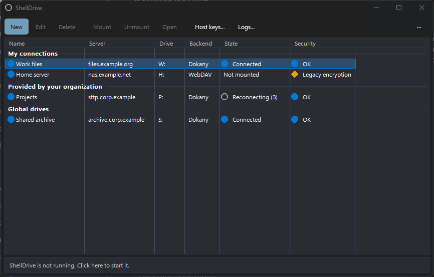
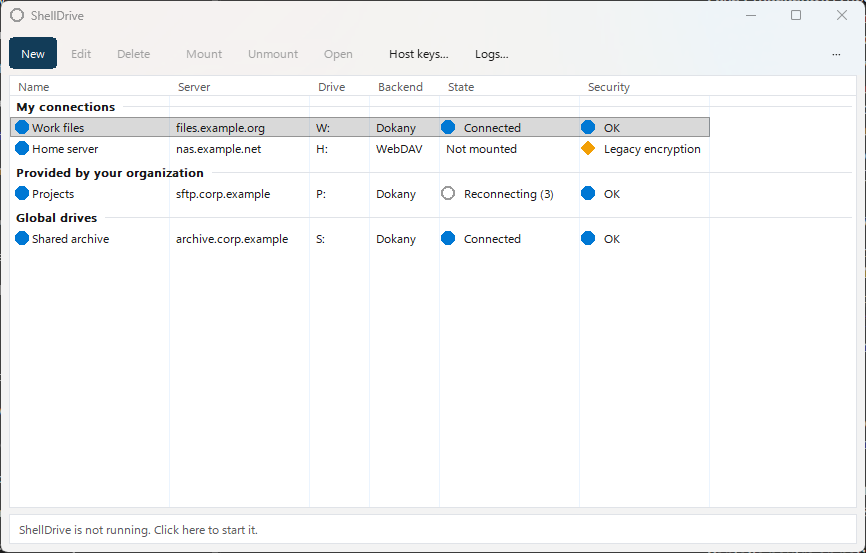
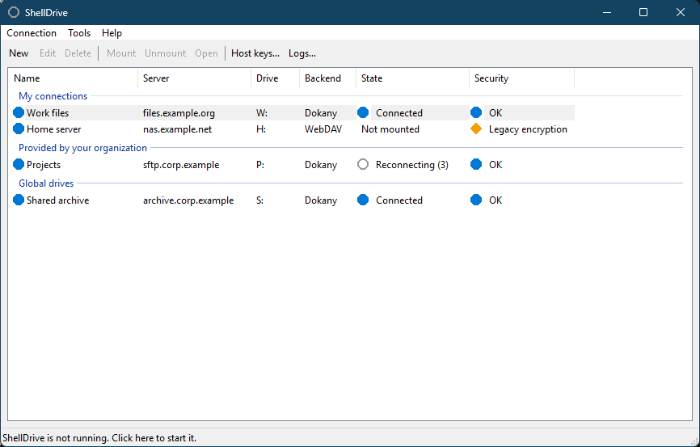
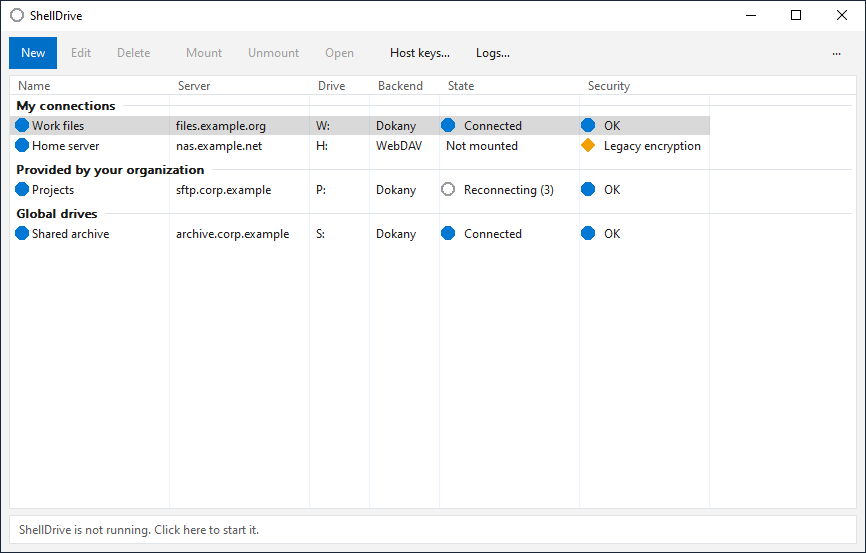
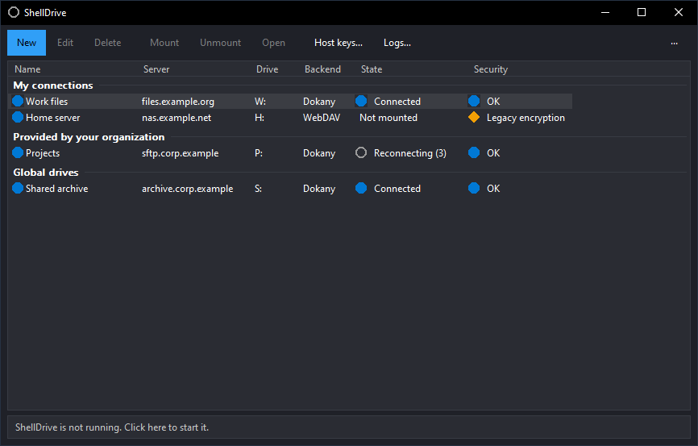
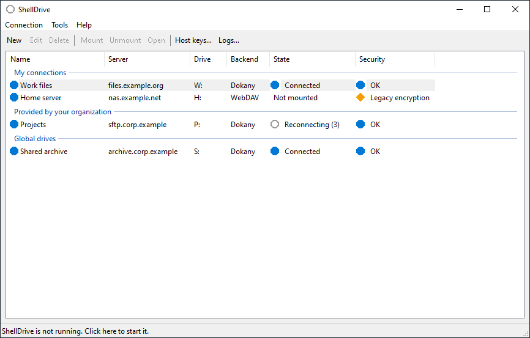
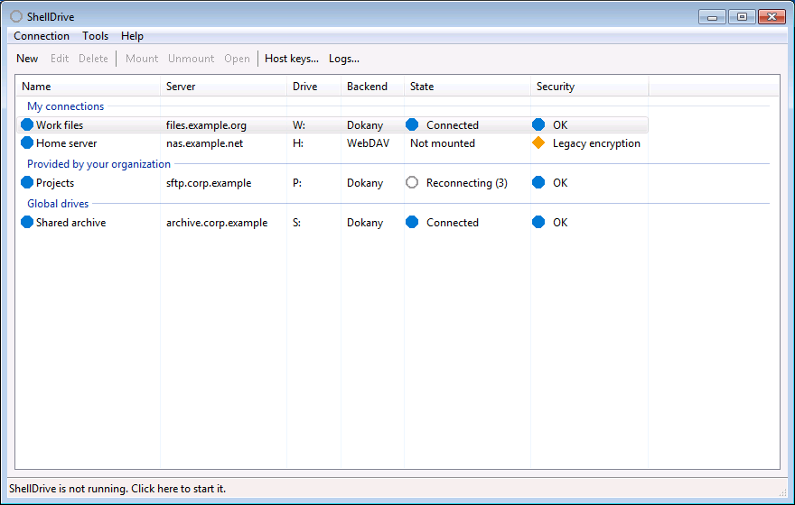
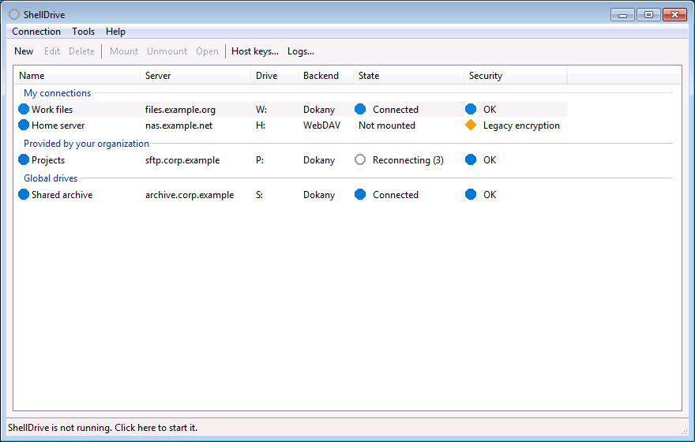

# ShellDrive

ShellDrive mounts remote hosts over SSH (SFTP) on Windows as drive letters, the way SMB shares are mapped.
It is native Win32 code in plain C, from Windows XP SP3 to Windows 11, with no third-party code: the SSH client,
the SFTP client and the cryptography are written for this project.

> **Status:** pre-1.0, version 0.1.0. There are no public downloads until the binaries are Authenticode-signed
> (see [Distribution](#distribution-and-updates)). Build from source to try it.

## Features

- **Two mount backends.** A local WebDAV server mapped through the Windows WebClient redirector (no driver, XP and
  later), and [Dokany](https://github.com/dokan-dev/dokany) (the signed upstream driver, Windows 7 SP1 and later)
  for a real drive with better semantics. ShellDrive picks Dokany when it is installed; each profile can force
  either.
- **Per-user and global drives.** Per-user mounts with remount at logon, and a system service that mounts global
  drives for every user before logon (per-machine installs).
- **Connectivity.** ProxyJump with several hops, HTTP CONNECT and SOCKS5 proxies per profile and per hop, and a
  pool of 1–4 SSH connections per mount.
- **Authentication.** Password and keyboard-interactive (OTP/2FA), ed25519, ECDSA and RSA keys (OpenSSH, PEM/PKCS#8
  and PuTTY `.ppk` v2/v3), OpenSSH certificates, Pageant and the Windows OpenSSH agent.
- **Host keys.** Trust on first use with a fingerprint prompt, OpenSSH-compatible `known_hosts`, PuTTY's and
  OpenSSH's stores read as extra sources, and verified host key rotation (`hostkeys-00@openssh.com`).
- **Cryptography.** Modern algorithms first (curve25519, ed25519, chacha20-poly1305, AES-GCM, ETM MACs), the
  post-quantum hybrid `mlkem768x25519-sha256`, Terrapin mitigation, and legacy algorithms ranked last with a
  warning in the UI.
- **Resilience.** Reconnection with backoff, keepalive, metadata and read caches, synchronous writes by default
  and an optional write-behind window.
- **Interfaces.** A CLI, a tray app with a main window (connection manager), Explorer integration (context menu,
  entries in "This PC", network locations) and an installer (EXE and MSI for GPO/Intune).
- **Six languages.** English, Spanish, French, Portuguese (Brazil), Italian and German in every component.

## Interface

The main window adapts to the Windows version (design: [`docs/design/06-ui-tiers.md`](docs/design/06-ui-tiers.md),
decision D47). Every tier keeps the same controls, keyboard access and accessibility; High Contrast and the
"Classic" appearance setting always use the classic window.

| Windows | Style |
|---|---|
| XP, High Contrast, Appearance "Classic" | Classic window with menu bar and toolbar |
| Vista, 7 | Aero: the toolbar on a glass band when desktop composition is on |
| 8, 8.1, 10 | Fluent: command bar with a "···" overflow menu, list on a card, status strip; dark mode from 10 1809 |
| 11 | Fluent with Mica (22H2 and later), rounded corners and a tray flyout to mount and unmount profiles |

### Windows 11

Fluent, dark and light (Windows 11 24H2, Mica backdrop):





Appearance set to "Classic" (the same window XP shows):



### Windows 10

Fluent, light and dark (Windows 10 IoT Enterprise LTSC 2021, 21H2), and the Classic appearance:







### Windows 7

Windows 7 SP1 with the "Windows 7 Basic" theme (no desktop composition, as in a virtual machine): the Aero tier
keeps the toolbar without the glass band. With composition on, the toolbar sits on a glass band.



The Classic appearance on Windows 7:



The screenshots come from the `--test-shot=<file.bmp>` smoke mode of `shelldrive-ui.exe`, with sample profiles,
on the development host (Windows 11) and the lab virtual machines (Windows 10 and 7). The Windows XP lab machine
is not installed yet; XP uses the classic window shown above.

## Command line

```text
shelldrive mount <profile> | --host [user@]host[:port]
shelldrive unmount <X:|profile> | --all
shelldrive list
shelldrive status [<X:|profile>] [--stats]
shelldrive profile import putty [<session>] | ssh-config [<file>]
shelldrive hostkey list | add | import | remove | accept-announced
shelldrive service list | mount <profile> | unmount <profile|X:> | status <profile|X:>
shelldrive diag [--check] | --bundle [FILE]
```

`shelldrive help <command>` lists the options of each command; `--json` prints machine-readable output and
`--lang` picks the language.

## Supported systems

| Flavour | Minimum OS | Notes |
|---|---|---|
| `x86-ia32` | XP SP3 | for CPUs without SSE2 |
| `x86-sse2` | XP SP3 | default x86 |
| `x64-xp` | XP x64 SP2, Vista | |
| `x64-modern` | Windows 10 | CFG and CET |
| `arm64` | Windows 10 on ARM | |
| `arm32` | Windows 10 on ARM, 11 up to 23H2 | best effort |

The setup program picks the flavour for the machine it runs on.

## Building

Visual Studio 2022 Build Tools with the v143 and v141_xp toolsets, Windows SDK 10.0.26100 and 7.1A, and CMake 3.25
or newer. From the repository root:

```powershell
cmake --preset x64-modern
cmake --build --preset x64-modern
ctest --preset x64-modern
```

[`docs/dev/building.md`](docs/dev/building.md) lists every preset, the checks the build enforces (XP import floor,
instruction-set audit) and the installer builds. `tools/ci-local.ps1 -Pipeline` runs the full local gate: all
presets, unit, interop and Dokany tests.

## Distribution and updates

A self-installing EXE (which can install the signed Dokany driver as an explicit option) and an MSI. Updates are
checked against a static mirror and verified with ShellDrive's own ed25519 signatures, so they do not depend on
the TLS stack of old Windows versions; the client asks before applying them. Code signing is planned through the
SignPath Foundation before a public 1.0.

## Documentation

- [`docs/requirements.md`](docs/requirements.md): product requirements and hard constraints.
- [`docs/design/`](docs/design/README.md): design documents (SSH and crypto, file system, apps and platform,
  build and install, threat model, UI tiers) and the accepted decisions.
- [`docs/dev/`](docs/dev/): build guide, milestone notes and lab results.
- [`AGENTS.md`](AGENTS.md): contribution rules (commits, language, localization).

## License

[MIT](LICENSE). Dokany is loaded dynamically and redistributed unmodified under its own license.
